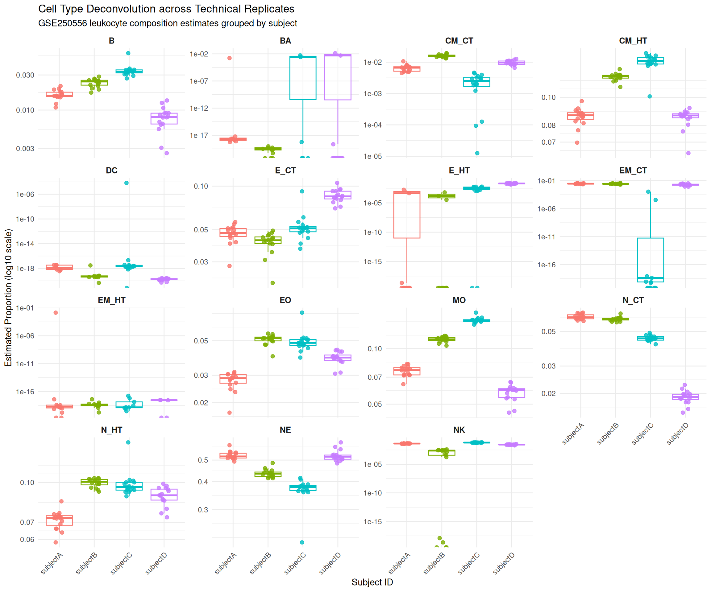

This vignette demonstrates two key quality control benchmarks using the public dataset **GSE250556**, which contains repeated technical replicates across multiple subjects:

1. **Sample Tracking and Mix-up Detection:** Inferring donor identity from SNP probes to verify concordance between metadata annotations and genetic fingerprints (`call_genotypes()`, `enumerate_sample_donors()`).
2. **Cell Type Deconvolution Reproducibility:** Assessing the consistency of leukocyte composition estimation (`estimateLC()`) across technical replicates of the same individual.


``` r
library(ewastools)
requireNamespace("dplyr")
requireNamespace("tidyr")
library(ggplot2)
```

## Data Preparation

We first download the raw IDAT files from GEO and then retrieve the sample metadata.
GEO provides all supplementary files of a series as a single tar archive
(`GSE250556_RAW.tar`) containing the gzipped IDAT files, which `read_idats()`
can import directly without decompressing them.


``` r
data_dir = "GSE250556_RAW"
dir.create(data_dir, showWarnings = FALSE)

# Download and unpack the archive of raw IDAT files (~1.1 GB)
if (length(list.files(data_dir, pattern = "\\.idat(\\.gz)?$")) == 0) {
  tar_file = file.path(data_dir, "GSE250556_RAW.tar")
  options(timeout = max(3600, getOption("timeout"))) # large file
  download.file(
    "https://www.ncbi.nlm.nih.gov/geo/download/?acc=GSE250556&format=file",
    method = "libcurl", destfile = tar_file,
    mode = "wb")
  untar(tar_file, exdir = data_dir)
  file.remove(tar_file) # delete the archive to save disk space
}
#> [1] TRUE
```


``` r
# 1. Fetch metadata from GEO
pheno_url = "https://www.ncbi.nlm.nih.gov/geo/query/acc.cgi?acc=GSE250556&targ=gsm&form=text&view=brief"
pheno = readLines(pheno_url)
pheno = split(pheno, cumsum(stringr::str_detect(pheno, "^\\^SAMPLE = GSM")))
names(pheno) = purrr::map_chr(pheno, 1) |> stringr::str_extract("GSM\\d+")

pheno_df = pheno |>
  purrr::map(tibble::tibble) |>
  dplyr::bind_rows(.id = "gsm") |>
  tidyr::separate_wider_delim(2, delim = " = ", names = c("var", "val"),
    too_many = "merge", too_few = "align_start") |>
  dplyr::filter(var == "!Sample_title") |>
  dplyr::mutate(subject_id = stringr::str_extract(val, "subject[A-Z]"))

# 2. Find local IDAT files
idats = list.files(data_dir, pattern = "_Grn\\.idat(\\.gz)?$", full.names = TRUE)
files_df = tibble::tibble(
  prefix = stringr::str_remove(idats, "_Grn\\.idat(\\.gz)?$"),
  gsm = stringr::str_extract(basename(prefix), "^GSM\\d+"))

# Merge metadata with local files
pheno_df = dplyr::inner_join(pheno_df, files_df, by = "gsm", unmatched = "error")
```


``` r
# 3. Read IDAT files
meth = ewastools::read_idats(pheno_df$prefix, quiet = TRUE)
#> [1] 1051943
```

## Benchmark 1: Sample Tracking and Mix-up Detection

Illumina DNA methylation microarrays contain a panel of SNP
(single nucleotide polymorphism) probes (prefixed with `rs`).
These probes can be used to call genotypes and verify that samples collected
from the same individual indeed share the same genetic profile.


``` r
# Identify SNP probes in manifest
snps = meth$manifest$index[meth$manifest$probe_type == "rs"]

# Calculate beta values for SNPs
M_snps = meth$M[snps, , drop = FALSE]
U_snps = meth$U[snps, , drop = FALSE]
beta_snps = M_snps / (M_snps + U_snps + 100)

# Call genotypes and cluster samples by shared donor profile
genotypes = ewastools::call_genotypes(beta_snps, learn = FALSE)
pheno_df$donor_id = ewastools::enumerate_sample_donors(genotypes)

# Verify mapping between metadata subjects and methylation-inferred donors
pheno_df |>
  dplyr::count(subject_id, donor_id) |>
  print()
#> # A tibble: 4 × 3
#>   subject_id donor_id     n
#>   <chr>         <dbl> <int>
#> 1 subjectA          1    16
#> 2 subjectB          2    16
#> 3 subjectC          3    16
#> 4 subjectD          4    16
```

As shown in the table above, all replicates for each subject group together into
a unique inferred donor ID, confirming that there were no sample mislabelings or mix-ups.

## Benchmark 2: Reproducibility of Cell Type Deconvolution

Whole blood consists of heterogeneous cell populations. Cell type deconvolution estimates the proportion of major leukocyte cell types from DNA methylation profiles. Across technical replicates of the same biological sample, cell type estimates should show high consistency and minimal variance.

### Pre-processing

Before cell type estimation, we apply detection p-value masking and dye-bias correction:


``` r
beta_full = meth |>
  ewastools::detectionP() |>
  ewastools::mask(0.01) |>
  ewastools::correct_dye_bias() |>
  ewastools::beta_values()
```

### Estimating Leukocyte Composition

We estimate cell proportions using the reference dataset for blood (`ref = "HRS"`):


``` r
LC = ewastools::estimateLC(beta_full, ref = "HRS")
pheno_df = cbind(pheno_df, as.data.frame(LC))
cell_types = colnames(LC)

head(LC)
#>           NE         EO            BA         MO      EM_CT        CM_CT
#>        <num>      <num>         <num>      <num>      <num>        <num>
#> 1: 0.4925583 0.03153626  1.452408e-18 0.08233782 0.02575208 6.590505e-03
#> 2: 0.4198475 0.05260778 -5.493842e-20 0.11687860 0.02160666 1.314048e-02
#> 3: 0.2143828 0.07580905 -1.070670e-17 0.15673305 0.00000000 9.353494e-05
#> 4: 0.5140518 0.03739388  0.000000e+00 0.05963437 0.01548316 8.051710e-03
#> 5: 0.5344942 0.02832686 -3.691689e-20 0.07192816 0.03170835 5.199181e-03
#> 6: 0.5398085 0.02683937  7.663980e-19 0.07186880 0.03531662 7.004378e-03
#>          E_CT       N_CT         EM_HT      CM_HT          E_HT       N_HT
#>         <num>      <num>         <num>      <num>         <num>      <num>
#> 1: 0.05491703 0.06561123  1.346272e-19 0.08569847  0.000000e+00 0.07338285
#> 2: 0.04769899 0.06130328  1.208175e-19 0.12508048 -1.845570e-19 0.10386758
#> 3: 0.09202178 0.04892891  1.770385e-17 0.10070301  5.745029e-03 0.14323552
#> 4: 0.09515268 0.01925145 -6.825794e-19 0.08404166  1.692134e-02 0.09701428
#> 5: 0.04517373 0.06094843  4.093801e-19 0.09145584  0.000000e+00 0.06605225
#> 6: 0.04102596 0.05844895  1.055063e-19 0.08136661  0.000000e+00 0.07072687
#>              B            DC         NK
#>          <num>         <num>      <num>
#> 1: 0.021191228 -4.768571e-20 0.04297456
#> 2: 0.022404588 -5.836231e-20 0.00000000
#> 3: 0.059378679  2.106253e-17 0.05149537
#> 4: 0.007957193  2.304132e-20 0.02553007
#> 5: 0.015654854  3.428622e-18 0.04140494
#> 6: 0.016002767 -2.827444e-20 0.04216014
```

### Visualizing Deconvolution Reproducibility

We reshape the data to plot the estimated proportions of each cell type across technical replicates, grouped by subject:


``` r
pheno_df |>
  tidyr::pivot_longer(
    cols = dplyr::all_of(cell_types),
    names_to = "Cell Type", values_to = "Proportion") |>
  ggplot(aes(x = subject_id, y = Proportion, color = subject_id)) +
  geom_boxplot(outlier.shape = NA, alpha = 0.5) +
  geom_jitter(width = 0.15, size = 1.8, alpha = 0.8) +
  scale_y_continuous(trans = "log10") +
  facet_wrap(vars(`Cell Type`), scales = "free_y") +
  theme_minimal() +
  labs(
    title = "Cell Type Deconvolution across Technical Replicates",
    subtitle = "GSE250556 leukocyte composition estimates grouped by subject",
    x = "Subject ID",
    y = "Estimated Proportion (log10 scale)",
    color = "Subject") +
  theme(
    legend.position = "none",
    strip.text = element_text(face = "bold", size = 10),
    axis.text.x = element_text(angle = 45, hjust = 1))
#> Warning in transformation$transform(x): NaNs produced
#> Warning in scale_y_continuous(trans = "log10"): log-10 transformation
#> introduced infinite values.
#> Warning in transformation$transform(x): NaNs produced
#> Warning in scale_y_continuous(trans = "log10"): log-10 transformation
#> introduced infinite values.
#> Warning: Removed 127 rows containing non-finite outside the scale range
#> (`stat_boxplot()`).
#> Warning: Removed 69 rows containing missing values or values outside the scale
#> range (`geom_point()`).
```



The plot illustrates high consistency across technical replicates within each subject, demonstrating robust reproducibility for `estimateLC()`.


